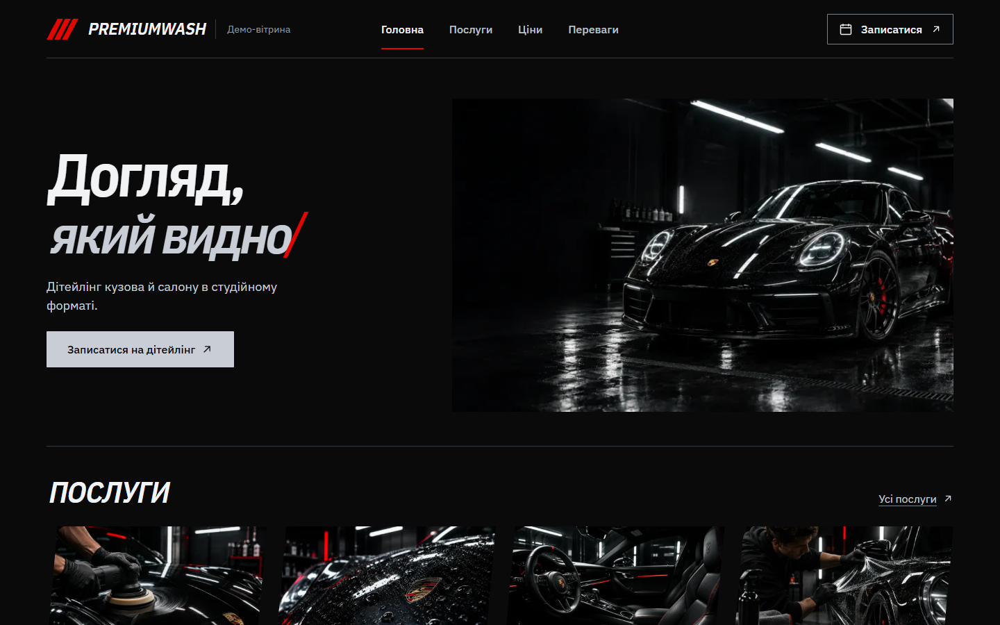
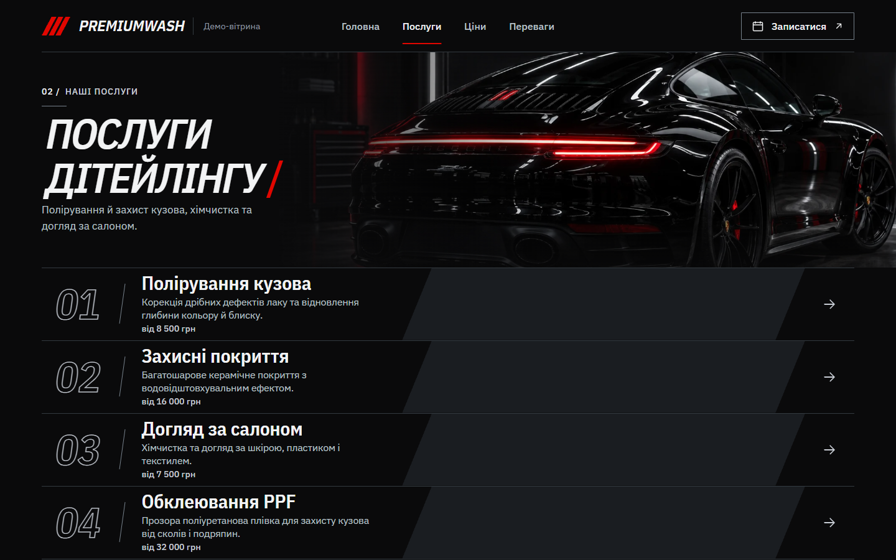
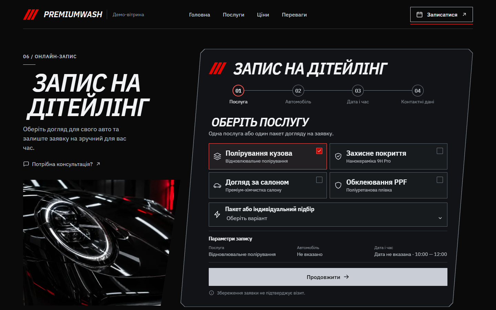

# PremiumWash 2.0

PremiumWash 2.0 is a cinematic, responsive booking experience for a premium car-care studio. It combines a service catalogue, guided online booking, consultation requests, and a protected operations dashboard in one SPA.

**Live demo:** [premium-car-washing.vercel.app](https://premium-car-washing.vercel.app/)

## Screenshots

Selected views from the local portfolio build at 1440×900:

| Home | Services |
| --- | --- |
|  |  |

| Online booking |
| --- |
|  |

The protected administrative dashboard is intentionally not included: no temporary local administrator or fabricated request data was available for a safe portfolio capture.

This is a demonstration commercial project built to showcase product thinking, frontend craft, and secure integration patterns. It is not a production service or a source of real customer data.

## Highlights

- Cinematic landing page with dedicated service, pricing, advantages, and booking routes.
- Guided booking flow for services, packages, individual selections, vehicle classes, dates, and time slots.
- Consultation flow with phone-first submission.
- Ukrainian user interface with responsive layouts and accessible interaction states.
- Protected admin area for authorized staff to review requests, search and filter records, inspect details, and update booking status.
- Explicit demo mode for local exploration and live mode for a configured backend.

## Technology

- React 19, React Router, Vite
- Motion for page transitions and reduced-motion-aware animation
- Supabase PostgreSQL, Auth, Row Level Security, and PostgREST RPCs
- Supabase Edge Functions with Deno
- Cloudflare Turnstile
- Vercel hosting and security headers

## Architecture

The frontend is a Vite-built React SPA. Routes are split with lazy imports; shared shell components provide navigation, focus management, dialogs, and animated transitions. Booking state and validation live in focused client modules, while responsive image variants are selected from the local asset catalogue.

The backend is intentionally narrow. The `submit-booking-request` Edge Function validates request shape, origin, rate limits, idempotency keys, Turnstile, and booking rules before calling protected database RPCs. PostgreSQL owns catalogue validation, slot/date rules, persistence, and authorization boundaries. Admin reads and status changes use restricted RPCs and active Supabase Auth profiles; server credentials never reach the browser.

## Booking and administration

Booking submissions support both scheduled visits and requests without a date. Reusing the same idempotency key is safe after a timeout or lost response; conflicting payloads are rejected. Consultation requests require a phone number and do not require a customer name.

The `/admin/login` and `/admin` routes are lazy-loaded and require an active administrator profile. There is no public registration or client-side role assignment.

## Security and performance

- Server-side Turnstile Siteverify with fail-closed handling.
- Exact-origin CORS for local development and the hosted application.
- CSP and additional HTTP security headers in `vercel.json`.
- RLS, restricted `SECURITY DEFINER` RPCs, fixed `search_path`, explicit grants, and server-only keys.
- Validation for phone, fields, dates, slots, payload size, media type, and duplicate JSON keys.
- Shared request admission limits, `Retry-After`, idempotency storage, and safe Ukrainian error messages.
- Lazy route chunks, initial-load optimization, responsive images, no-store responses, and reduced-motion support.

## Local development

Requirements: Node.js, npm, Docker, and the Supabase CLI for local backend work.

```powershell
npm install
npm run dev
```

The default Vite setup is safe demo mode. To use a local Supabase instance, configure environment variables in your local shell or an untracked `.env.local` file:

```text
VITE_BOOKING_MODE=live
VITE_BOOKING_API_URL=http://127.0.0.1:54321
VITE_SUPABASE_URL=http://127.0.0.1:54321
VITE_SUPABASE_ANON_KEY=<local-anon-key>
VITE_TURNSTILE_SITE_KEY=<local-test-site-key>
```

Apply the ordered migrations and seed data only to an approved local project. Server-only values such as `SUPABASE_SECRET_KEY` and `TURNSTILE_SECRET_KEY` belong in the Edge Function environment, never in Vite variables or source control. See [`supabase/README.md`](supabase/README.md) for the local backend workflow.

Useful commands:

```powershell
npm run lint
npm run build
```

## Project status

The repository is structured as a portfolio-quality demonstration: production credentials, administrator identities, personal data, and deployment operations are intentionally excluded.
